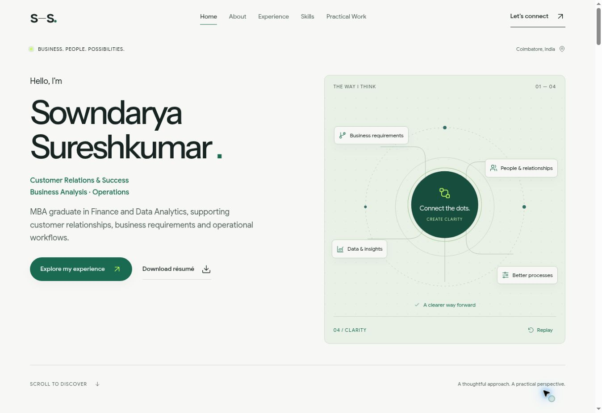

# Portfolio refinement audit

Repository: sowndaryasuresh/Sowndarya-s-Portfolio. Original commit: 16577dcd48bfa9d562f4293dd44e88bf5f002b86.

| Priority | Finding | Implemented change |
| --- | --- | --- |
| High | Skills and five practical-work areas were generated only by JavaScript | Moved content and SVG icons into HTML; filters progressively enhance existing cards |
| High | Multiple later CSS refresh blocks overrode mobile rules | Replaced with one mobile-first stylesheet, design tokens and grouped breakpoints |
| High | Complex hero illustration shrank labels on narrow screens | Container-based switch to a readable stacked sequence below 420px |
| High | Resume compressed all experience, education and credentials into one page | Exactly two A4 pages, 15mm margins, 10.5pt body text and embedded brand fonts |
| High | Jeevan description was vague and lacked supporting detail | Kept one factual operational-support bullet and recorded verification questions |
| Medium | Scroll reveal observers repeatedly hid and reanimated content | One-time entrances; content remains readable while waiting for observers |
| Medium | Pointer handlers changed layout properties every event and moved illustration nodes | Transform-only cursor updates, at most one scheduled frame per pointer event batch; no idle loop or parallax |
| Medium | Workflow signal animated continuously | Finite sequence, cancellable timer, rapid-replay handling and reduced-motion support |
| Medium | Mobile navigation focus/background behaviour needed refinement | Background inert while open; Escape close, focus loop, target focus and breakpoint reset |
| Medium | Customer success missing from hero role line | Unified Customer Relations & Success / Business Analysis / Operations positioning |
| Medium | Generic tool and practice descriptions | Evidence-based experience bullets and objective / method / tools / demonstrated capability in conceptual examples |
| Medium | CTA hierarchy and focus styling varied | Emerald primary pill, quieter resume link, lime contact download and consistent focus/touch states |
| Medium | External fonts added requests | Self-hosted Latin-subset WOFF2 fonts, two preloads and retained OFL licences |
| Low | Missing canonical and social-sharing fields | Canonical, Open Graph URL/image/alt and Twitter card metadata |

## Wording examples

- Hero: “Business Analysis · Customer Relations / Business Operations · Analytics” becomes “Customer Relations & Success / Business Analysis · Operations.”
- Tool bullet: “Worked with Odoo CRM and Notion” becomes “Used Odoo CRM and Notion to support documentation and collaborative activities.” The original resume supplies this context.
- Jeevan: “Contribute to process improvements and operational activities” becomes “Support operational activities and contribute to process improvement.” This is a clarity edit, not an expansion of responsibility.
- Turing: separate response-evaluation statements become concise bullets covering accuracy, relevance, multilingual/multimodal evaluation, validation and structured feedback.

## Content integrity

Employer names, dates, contact information, education and existing credential names remain aligned with the original resume. No numerical achievements or client outcomes were invented. UAT, functional testing, ERP operations and reporting are retained from the baseline as capabilities, with role-specific examples still needed. All five practice workflows are expressly conceptual.

## Resume verification

Two pages, each 595.2756 × 841.8898pt (A4). Content fonts: Instrument Sans Medium, Google Sans Regular and Semibold, embedded with Unicode maps. Readable single-column text extraction: 1,519 characters on page 1 and 1,509 on page 2. Email, LinkedIn and portfolio links checked. Both final pages rendered and visually reviewed. No actual ATS vendor scoring or hiring outcome is claimed.

## Visual system and motion

The original off-white, emerald and lime identity and both abstract artworks are preserved. Instrument Sans headings and Google Sans body text share a consistent spacing system. Primary emerald pill buttons, secondary underlined links and the lime contact download establish a clear hierarchy. Content becomes a single column on small screens; skills and practice details remain available without JavaScript.

Entrances run once using transforms. Text keeps full opacity throughout animations so its contrast remains stable. The hero sequence finishes rather than looping indefinitely, and rapid replays cancel previous animation/timer work. Reduced-motion mode removes movement and smooth scrolling. The decorative cursor is limited to fine pointers, keeps the native pointer visible, and does not run while idle.

## Browser findings resolved during QA

- An immediate mobile-menu reopen exposed a focus race. The menu now uses the HTML hidden state and immediate visibility changes.
- Lighthouse caught low text contrast during the workflow entrance and a mismatch between the visible logo and its accessible name. Text animation no longer fades to low opacity; the label includes the visible initials. The subsequent Lighthouse run scored 100 in accessibility.
- Test infrastructure uses an official Playwright container and matching dependencies. The disposable runner home ownership is aligned for Firefox; browser-launch failures are recorded without hiding other engines' results.

- The 200% text-enlargement test exposed 29px of horizontal overflow. Wrapping now handles long text; diagrams and principles reflow based on readable, font-relative track widths.

## Validation results

### Laboratory performance

Lighthouse 13.6.0, mobile simulation against the candidate served locally in GitHub Actions: performance 100, accessibility 100, best practices 100, SEO 100; LCP 0.9s, CLS 0, TBT 0ms. These are laboratory results, not a real-user performance guarantee. Field INP has not been measured. The final results file will retain the exact metrics and environment.

### Responsive and interaction checks

Validated 19 November 2026 with Playwright 1.65.1. [Successful test run](https://github.com/sowndaryasuresh/Sowndarya-s-Portfolio/actions/runs/44505888978), tested code commit `0f4333bc6630af4d04559120c0fab3198632bb12`.

| Browser engine | CSS viewport widths, all at 900px height | Result |
| --- | --- | --- |
| Chromium | 320, 360, 375, 390, 430, 550, 768, 1024, 1280, 1440, 1920 | Passed; no page or visible-element overflow |
| Firefox | 320, 768, 1440 | Passed; no overflow |
| WebKit | 320, 768, 1440 | Passed; no overflow |

All three engines passed navigation open/close, Escape, focus loop, fragment history, all skill filters, all disclosures by keyboard/mouse, rapid animation replay, copy feedback/fallback, PDF download, local asset responses, anchor targets, email/LinkedIn link targets, back-to-top, long content, reduced motion, JavaScript-disabled content and touch cursor checks. Functional viewport: 390 × 844. Landscape viewports: 844 × 390 and 667 × 375. No browser exceptions or failed asset responses were recorded.

Chromium also passed clipboard-content verification; 640 × 450 reflow representing the CSS viewport of a 1280px window at 200% zoom; and 200% text enlargement at that viewport. This is a layout-equivalence and text-size test, not automation of the browser's native zoom control. Screenshots were reviewed at 320, 390, 550, 768, 1024 and 1440px, plus enlarged text.

Axe scans at 390 × 1000 and 1440 × 1000, with practical-work details expanded, reported zero violations for the WCAG 2 A/AA, 2.1 AA and 2.2 AA tag set. Keyboard behavior was tested separately. This does not establish full WCAG conformance, and physical phones, a screen reader and native Safari were not tested.

Machine-readable evidence: [browser results](qa-results.json), [Lighthouse summary](lighthouse-summary.json). Full reports and screenshots are attached to the workflow run with a 14-day retention period.

## Changed files

- `index.html`: static content, semantics, metadata and versioned runtime/PDF URLs.
- `style.css`: shared tokens, responsive layouts, contrast, enlarged-text reflow and motion.
- `app.js`: navigation, filters, clipboard feedback, finite workflow and cursor.
- `assets/Sowndarya-Sureshkumar-Resume.pdf` and `assets/fonts/`: new PDF, font files and licences.
- `scripts/build_resume.py`, `scripts/qa.cjs`, `.github/workflows/quality.yml`, `package.json`, `package-lock.json`, `.gitignore`: reproducible résumé and checks.
- `README.md` and `docs/`: content evidence, role variants, audit and QA results.

## Live deployment

The tested site is published through the existing main-branch GitHub Pages configuration. A live-browser check identified cached assets from the previous version. Versioned CSS, JavaScript and PDF links now prevent that mixed-version state; each versioned URL was checked against the tested file bytes. The final runtime commit also passed the complete [main-branch quality run](https://github.com/sowndaryasuresh/Sowndarya-s-Portfolio/actions/runs/44506684508).

Live verification on 19 November 2026: GitHub Pages deployment succeeded for runtime commit `8603a93ec43cbcdc52c5324552f74f5e1427bdb4`. The existing public URL displayed the revised hero, all 20 capability cards and five conceptual workflows. CRM filtering returned the three expected cards; All restored the full list; a workflow disclosure opened; copy-email feedback succeeded; and back-to-top navigation worked. The browser-downloaded PDF matched the tested two-page file byte for byte. Public HTML, CSS, JavaScript and PDF responses were HTTP 200 and matched the local tested bytes. Browser-extension diagnostic errors were unrelated to the portfolio; the automated site tests recorded no application errors.

[Live portfolio](https://sowndaryasuresh.github.io/Sowndarya-s-Portfolio/) · [Two-page résumé](https://sowndaryasuresh.github.io/Sowndarya-s-Portfolio/assets/Sowndarya-Sureshkumar-Resume.pdf?v=20261119-1)

